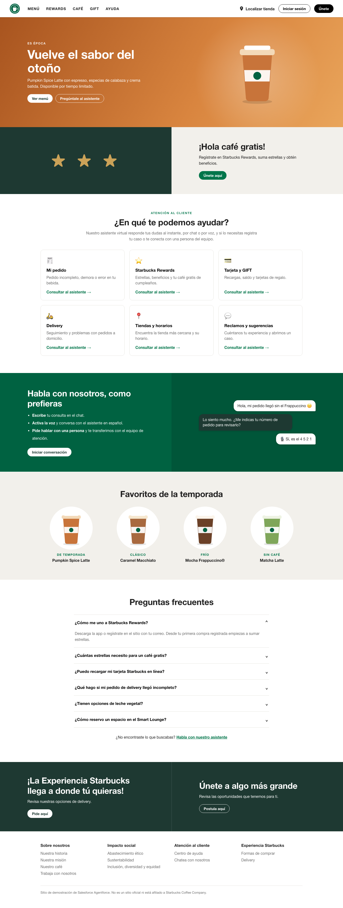

# Starbucks Chile · Demo de atención con Agentforce



Landing de demostración inspirada en [starbucks.cl](https://www.starbucks.cl/) para mostrar cómo se gestionan **preguntas frecuentes y casos de clientes** con un agente de Agentforce, por **chat y por voz**.

> Sitio de demostración. No es un sitio oficial ni está afiliado a Starbucks Coffee Company.

- El chat es el widget **Enhanced Chat v2** de Salesforce, con **Agentforce Voice** (botón para cambiar entre texto y voz).
- Las tarjetas de "¿En qué te podemos ayudar?" y los botones "Pregúntale al asistente" abren el widget con `embeddedservice_bootstrap.utilAPI.launchChat()` y sugieren una pregunta.
- Si el cliente pide hablar con una persona, el agente escala por Omni-Channel a la cola **Messaging**.

## Arquitectura

```
Navegador (landing React)
   │  bootstrap.min.js  →  widget Enhanced Chat v2 (despliegue VoiceChat)
   ▼
Salesforce Messaging (canal VoiceChat)  →  agente "Asistente_Web"
   │                                         └─ Agentforce Voice (STT + TTS)
   └─ escalamiento: flujo Asistente_Web_Escalamiento → cola Messaging
```

El sitio es estático y se publica en **GitHub Pages**: https://cbunstersf.github.io/asistente-web-agentforce/ (no guarda credenciales).

## Componentes en Salesforce

| Elemento | Valor |
|---|---|
| Agente | `Asistente_Web` (Agentforce Service Agent, Agent Script, locale `es_MX`) |
| Conexiones | Messaging y Enhanced Chat v2 (`customer_web_client`) + `modality voice` |
| Canal / despliegue | `VoiceChat` (Enhanced Chat v2, Agentforce Voice activado) |
| Flujo de escalamiento | `Asistente_Web_Escalamiento` → cola `SDO_Service_Messaging` |

El snippet del widget está en `web/index.html`. El dominio `cbunstersf.github.io` está permitido en dos lugares: CORS (`salesforce/force-app/main/default/corsWhitelistOrigins/`) y los dominios que pueden mostrar el sitio del chat en un iframe (`siteIframeWhiteListUrls` en `salesforce/force-app/main/default/sites/ESW_VoiceChat_1791921320202.site-meta.xml`). Si publicas en otro dominio, agrégalo en ambos y despliega.

## Puesta en marcha (local)

```bash
npm install --include=dev
npm run dev               # http://localhost:5173
```

El widget de Salesforce solo carga en los dominios configurados en el canal, así que en `localhost` se ve la landing sin el chat.

Modo producción:

```bash
npm run build
npm start                 # http://localhost:3001
```

## Publicar en GitHub Pages

```bash
npm run publish:pages
```

Compila la landing y la sube a la rama `gh-pages` (`scripts/publish-pages.sh`). GitHub Pages la sirve en https://cbunstersf.github.io/asistente-web-agentforce/ en uno o dos minutos. Como es un sitio estático, no se detiene por inactividad.

## Modificar el agente

El agente se define en `salesforce/force-app/main/default/aiAuthoringBundles/Asistente_Web/Asistente_Web.agent`. La conexión Enhanced Chat v2 y la voz se configuraron en Agentforce Builder: antes de editar el archivo, recupera la última versión (`sf project retrieve start -m AiAuthoringBundle:Asistente_Web`) para no perder esos cambios. Luego valida, publica y activa:

```bash
sf agent validate authoring-bundle --api-name Asistente_Web
sf agent publish authoring-bundle --api-name Asistente_Web --json
sf agent activate --api-name Asistente_Web --version <N>
```

## Solución de problemas

| Síntoma | Causa probable |
|---|---|
| No aparece el botón del chat | El dominio no está permitido (consola: `violates ... frame-ancestors` → falta en `siteIframeWhiteListUrls`), o el despliegue no está publicado |
| No aparece el botón de voz | Falta "Allow Agentforce Voice for Enhanced Chat" en el canal; el botón aparece después del primer mensaje |
| La voz responde en inglés | Idioma por defecto del agente o voz de Voice Settings en inglés |
| La página muestra una versión antigua | GitHub Pages tarda 1–2 min en publicar; recarga sin caché |
